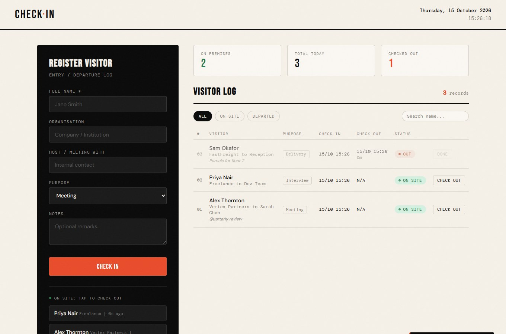
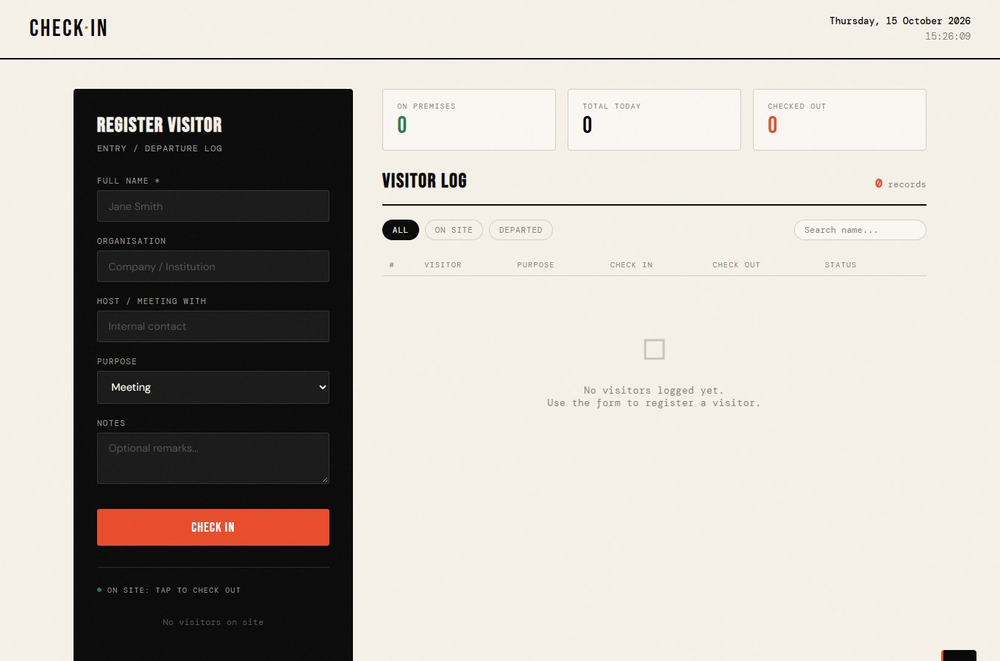
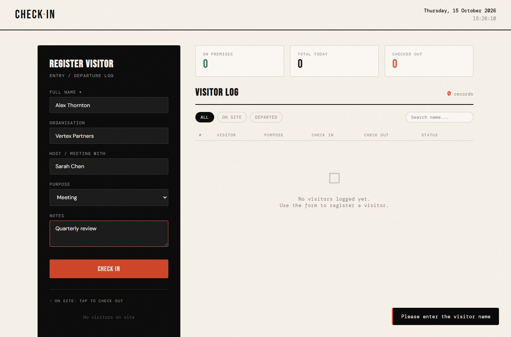
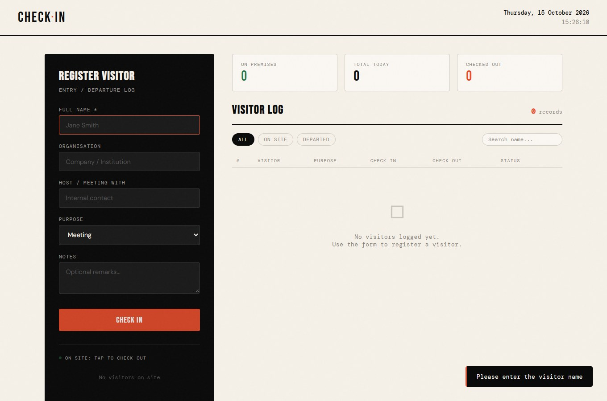
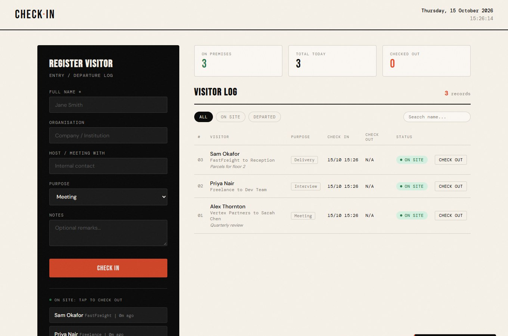
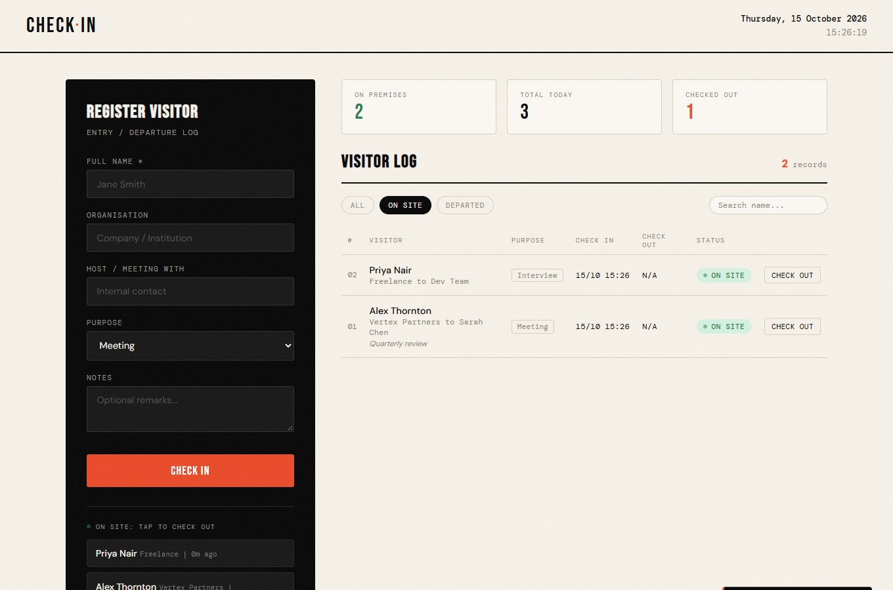
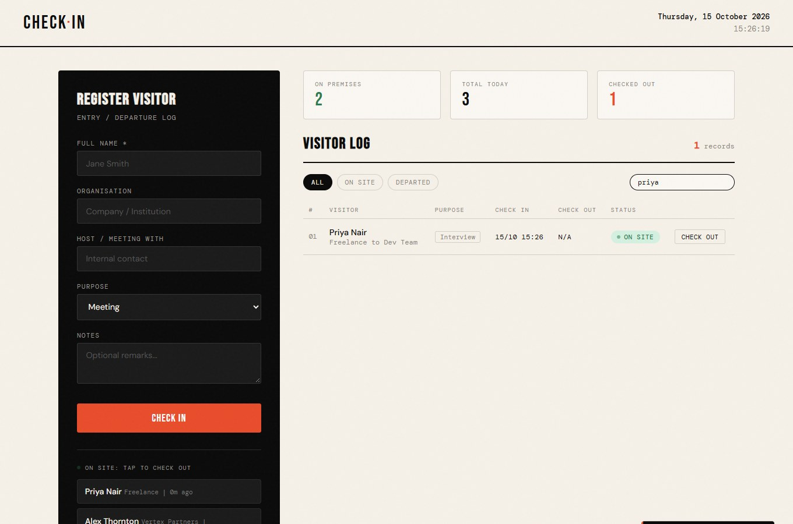
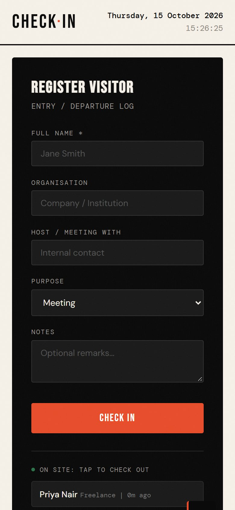

# Basic Visitor Check-In

A lightweight, dependency-free visitor log for checking people in and out of a premises. It runs entirely in the browser with plain HTML, CSS and JavaScript. There is no build step, no backend and nothing to install.



## Table of contents

- [Features](#features)
- [Getting started](#getting-started)
- [How to use it](#how-to-use-it)
- [Screenshots](#screenshots)
- [How it works](#how-it-works)
- [Project structure](#project-structure)
- [Testing](#testing)
- [Limitations](#limitations)
- [Ideas for later](#ideas-for-later)

## Features

- **Register visitors** with full name, organisation, host, purpose of visit and optional notes
- **One-click check out** from either the "On Site" list in the side panel or the log table
- **Live statistics** for people currently on the premises, total visitors today and visitors checked out today
- **Filter** the log by All, On Site or Departed
- **Search** the log by visitor name
- **Time on site** is shown for every visitor who has left, and a running "time ago" for those still inside
- **Saved in the browser** using `localStorage`, so a refresh or closed tab does not lose the log
- **Safe by default**: everything typed into the form is escaped before it is displayed, so HTML or script text is shown as plain text and never executed
- **Responsive** layout that works on desktop, tablet and phone
- **Keyboard friendly**: the form submits with Enter and the on-site list uses real buttons

## Getting started

### Option 1: open the file

Download or clone the repository and open `index.html` in any modern browser.

### Option 2: serve it locally

```bash
git clone https://github.com/MrPettitt/Basic-Visitor-Check-In.git
cd Basic-Visitor-Check-In
python -m http.server 8000
```

Then visit <http://localhost:8000>.

Any static file server works. Node users can run `npx serve` instead.

### Fonts

The page loads Bebas Neue, DM Mono and DM Sans from Google Fonts. Without an internet connection the app still works and falls back to system fonts.

## How to use it

### 1. Start with an empty log

When nothing has been logged, the log shows an empty state and the "On Site" list says no visitors are present.



### 2. Register a visitor

Fill in the form on the left. Only **Full Name** is required.

| Field | Required | Notes |
| --- | --- | --- |
| Full Name | Yes | Shown in the log and the On Site list |
| Organisation | No | Company or institution the visitor represents |
| Host / Meeting With | No | Internal contact the visitor is seeing |
| Purpose | No | Meeting, Interview, Delivery, Maintenance, Event, Contractor or Other |
| Notes | No | Free text remarks, shown under the visitor in the log |



If you press **Check In** without a name, a message appears and the name field is highlighted.



### 3. See who is on site

After checking people in, the log fills up and the statistics update. The newest visitor appears at the top, and each row shows a status badge and the check-in time.



### 4. Check a visitor out

There are two ways to check someone out:

- Click their name in the **On Site: tap to check out** list under the form
- Click **Check Out** on their row in the log

The status changes to **Out**, the check-out time is recorded, the time on site is calculated and the counters update.


### 5. Filter and search

Use the **All**, **On Site** and **Departed** buttons to narrow the log.



Type in the search box to find a visitor by name.



### 6. Use it on a phone

The layout stacks into a single column on narrow screens, and the log table scrolls sideways inside its own container instead of stretching the page.

<p align="center">
  
</p>

## Screenshots

| Empty | Validation |
| --- | --- |
|  |  |

| Form filled | Populated log |
| --- | --- |
|  |  |

| Checked out | Filtered |
| --- | --- |
|  |  |

## How it works

### Data model

Each visitor is stored as a small object:

```js
{
  id: 1760538360000,          // timestamp used as a unique id
  name: "Alex Thornton",
  org: "Vertex Partners",
  host: "Sarah Chen",
  purpose: "Meeting",
  notes: "Quarterly review",
  checkin: Date,              // set when the visitor is registered
  checkout: Date | null       // null while the visitor is on site
}
```

The whole list is saved as JSON under the `checkin-visitors` key in `localStorage` after every check-in and check-out, and is loaded again when the page opens.

### Statistics

| Counter | Meaning |
| --- | --- |
| On Premises | Every visitor without a check-out time, regardless of the day they arrived |
| Total Today | Visitors whose check-in date is today |
| Checked Out | Visitors who arrived today and have since left |

Someone who arrived yesterday and was never checked out still counts as on premises, so they are not forgotten.

### Rendering and safety

All visitor text goes through an `escapeHtml` helper before being inserted into the page, so characters such as `<` and `>` are shown literally. Click handling uses a single delegated listener on `data-checkout` attributes instead of inline `onclick` handlers.

## Project structure

```
Basic-Visitor-Check-In/
  index.html            Page markup
  css/
    styles.css          All styling and responsive rules
  js/
    app.js              State, storage, rendering and events
  docs/
    screenshots/        Images used in this README
  README.md
  .gitignore
```

## Testing

The app was exercised in Microsoft Edge using an automated browser script. The checks below all passed:

- Empty state is shown on first load
- Submitting without a name shows a validation message
- Three visitors can be checked in, and the form clears afterwards
- Checking out from the On Site list updates the counters and the table
- The All, On Site and Departed filters return the expected rows
- Searching by name narrows the log, and a search with no match shows the empty state
- Records are still there, with the same counters, after a page reload
- Text such as `` and `<script>` tags is displayed as plain text and never runs
- The log table fits its container at desktop width
- The page does not scroll sideways on a 390px wide phone screen
- No errors are logged to the browser console

## Limitations

- Data is stored per browser and per device. Two computers at a reception desk will not share a log.
- Clearing site data in the browser deletes the log.
- There is no export, login or edit feature yet.

To wipe the log manually, run this in the browser console:

```js
localStorage.removeItem('checkin-visitors');
```

## Ideas for later

- Export the log to CSV
- Print a visitor badge on check-in
- Edit or delete a record
- A shared backend so several devices see the same log
- Automatic prompt to check out visitors still on site at the end of the day
